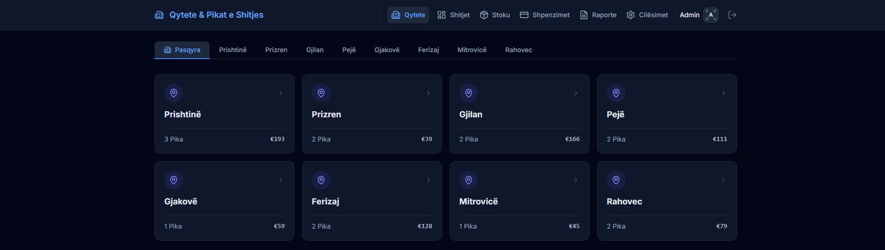
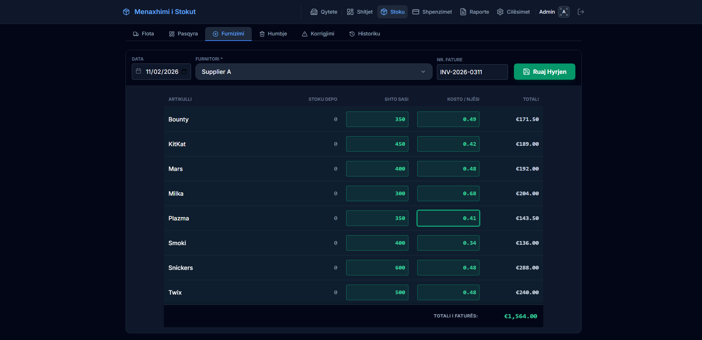
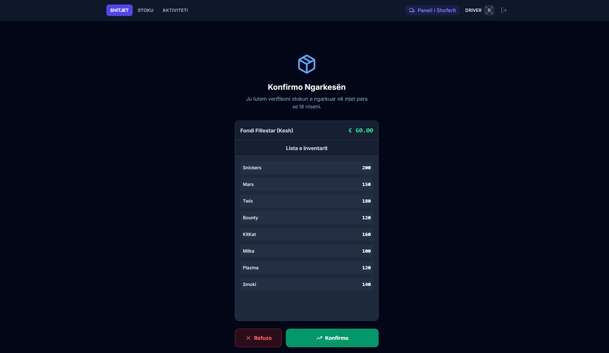
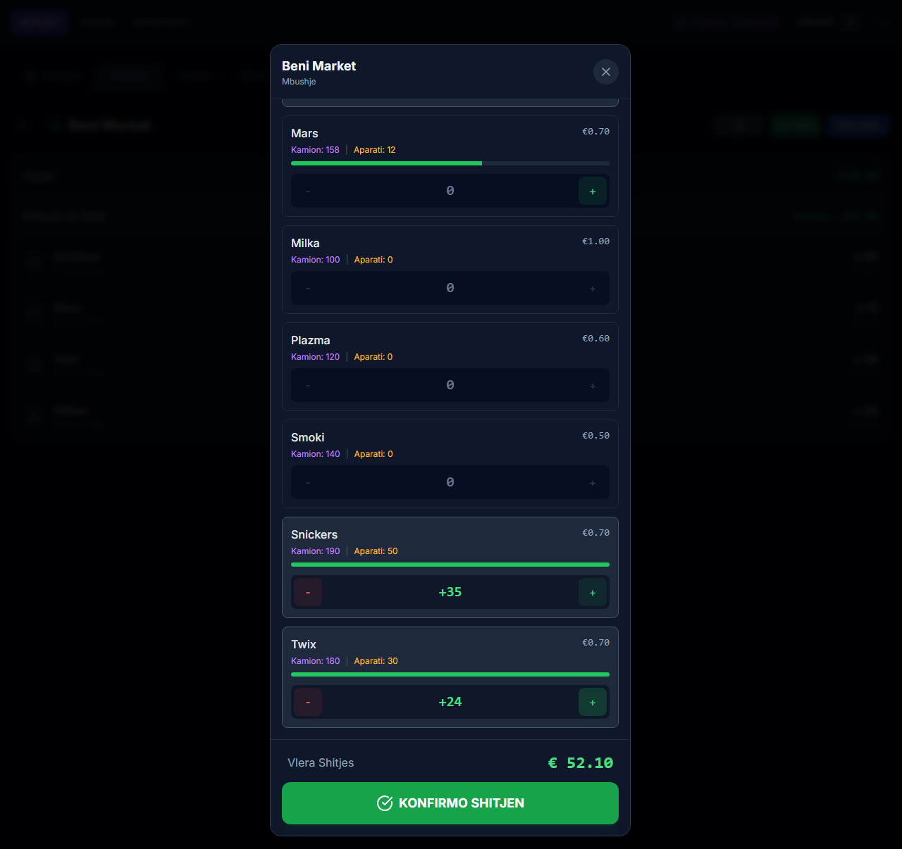
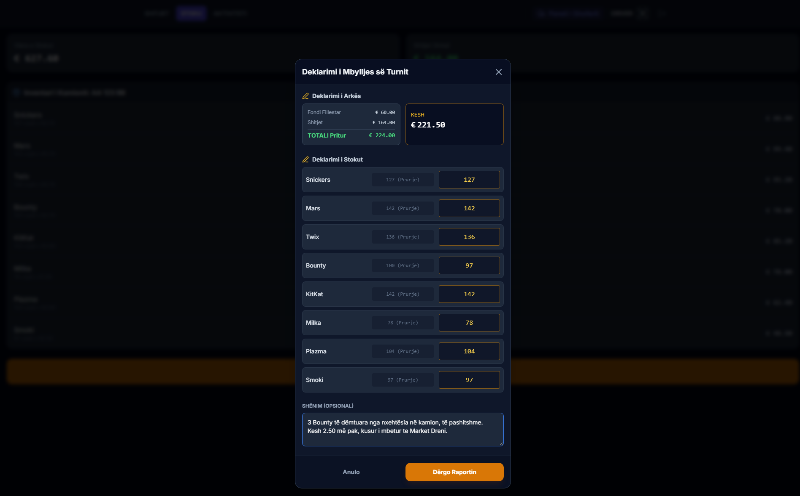
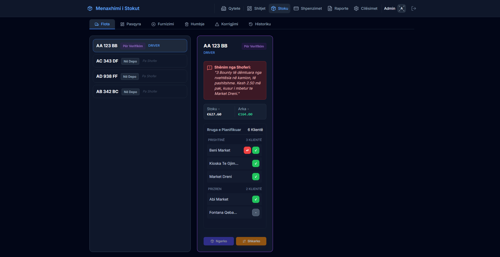
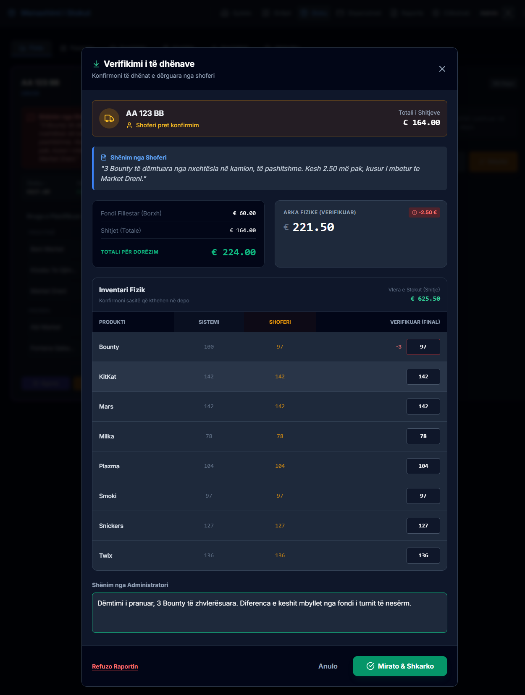
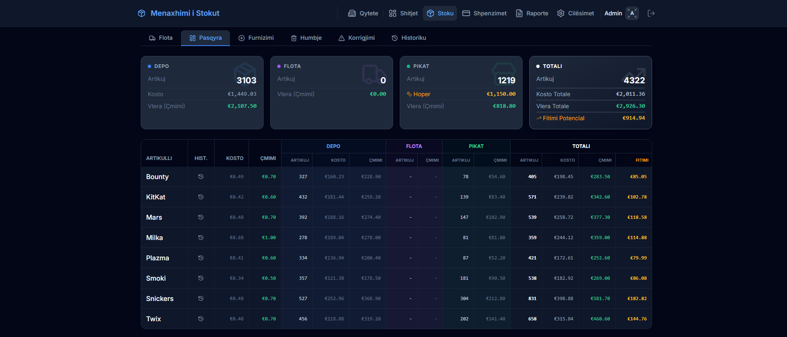

# LogiTrack

Logistics and stock control for van sales. Stock leaves a depot on a truck, a driver runs a route of machines placed inside other businesses, and the shift is declared and approved when the truck comes back. Built and sold.

The source is private. This page is the walkthrough.

---

## The operation

The machines sit inside other businesses - a shop, a bar, a school kiosk - and the host is paid a bonus on what the machine turns over. The stock inside stays yours, and so does the cash in the hopper. LogiTrack tracks both from the moment they leave the depot: which truck carried them, which driver signed for them, which machine they went into, and what came back.

The opening screen is the operation at a glance: every city, how many machines are in it, and the value of the stock sitting in them. Open a city and the same figures appear per machine, down to when each was last served.

The figures in the screenshots below are demonstration data, not a client's.

---

## Stock in

A supply is recorded against a supplier and an invoice number, line by line at unit cost. Cost is held as a weighted average and recomputed on each intake, so the valuation follows what was actually paid rather than a list price.

A supply can be reversed, and the reversal is linked to the entry it reverses rather than deleting it.

---

## The shift has two sides

An administrator loads the truck from the depot and sets the cash float. The shift then waits: the driver sees the count and the float, and either confirms it or rejects it with a note that goes back to the administrator.

The shift carries the state: `AWAITING_LOAD_CONFIRMATION`, `LOAD_REJECTED`, `ACTIVE`, `PENDING_APPROVAL`, `COMPLETED`. It also carries its opening position, float and inventory, against which the closing declaration is measured.

---

## At the machine

Two separate actions, deliberately not the same screen.

**Korrigjim** moves stock without money. It fills a machine for the first time, and afterwards it rebalances: a slow line comes down, a fast one goes up, in a single action. Quantities are signed, so stock can come back off the machine onto the truck. The cash float left in the hopper for change is set here too.

**Mbushje** is the refill, and the refill is the sale. A machine held at 40 that is topped up by 35 has sold 35, so the quantity entered is both the stock going in and the revenue recorded. The screen shows what is on the truck against what the machine holds, and the line price applied, which can be set per machine rather than globally.

A visit that produces no sale is still recorded, with a note and a reason, so the route history distinguishes a point that was not reached from one that was visited and sold nothing.

---

## The return

The driver declares what is coming back: cash, and a count for every line on the truck. The expected cash is shown beside the field - float plus sales - so a difference is visible before the form is sent rather than discovered later. A note explains it.

On the depot side the truck now reads **Për Verifikim**, carrying the driver's note, the stock and cash figures, and the route with each point marked by what happened there.

---

## Reconciliation

The closing screen puts three columns side by side: what the system expected, what the driver declared, and what is actually counted in. Differences are calculated rather than left to the person doing the counting, and they are shown per line, not only as a total.

Here the cash is €2.50 short against €224.00 expected, and Bounty comes back 97 against 100. The administrator can approve it or send the report back to the driver.

---

## Where the stock is

One matrix for the whole operation: each product across the depot, the trucks and the machines, valued at cost and at price, with the margin that sits in it. The truck column is empty because the shift has closed, so every unit is either in the depot or in a machine, and the three columns reconcile to the total. The hopper figure is the company's own cash, out in the field as change.

---

## Underneath

Users, trucks, products, cities, sales points, suppliers and expenses are voided rather than removed, so history stays readable. Money is held as `Decimal`. An expense can be attached to the thing that caused it - a truck, a driver, a machine or a worker - and the category decides which.

Roles are `ADMIN`, `OPERATOR` and `DRIVER`. A driver sees their own truck and shift; the depot sees the whole operation.

---

## Stack

- React with TypeScript on Vite, Tailwind, installable as a PWA. Drivers work from a phone.
- Express with Socket.IO, Prisma against PostgreSQL. State changes reach every connected device live.
- Deployed to a server rather than installed on site: a provisioning script sets up Node, the database role, migrations and the build, systemd runs the server and nginx serves the frontend and proxies the API and the socket. The deployment script was written by Kujtim.

---

## Why this is a walkthrough and not a repository

LogiTrack is a commercial product with a paying client. I am happy to discuss the reasoning behind any of it: why the refill is the sale, why the load is confirmed by the person who has to answer for it, or how the cost average survives an intake at a different price.

Enver Kollari · [github.com/enverkollari](https://github.com/enverkollari) · enverkollari@hotmail.com
